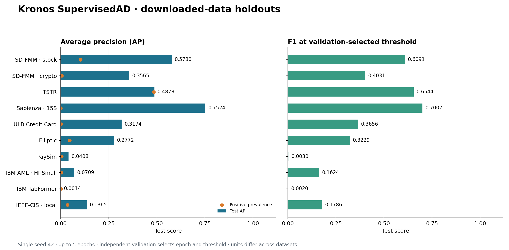
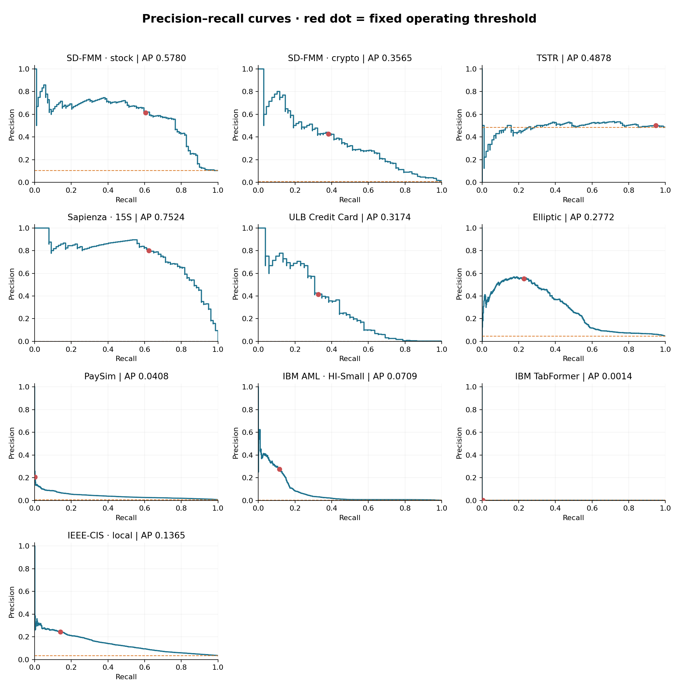
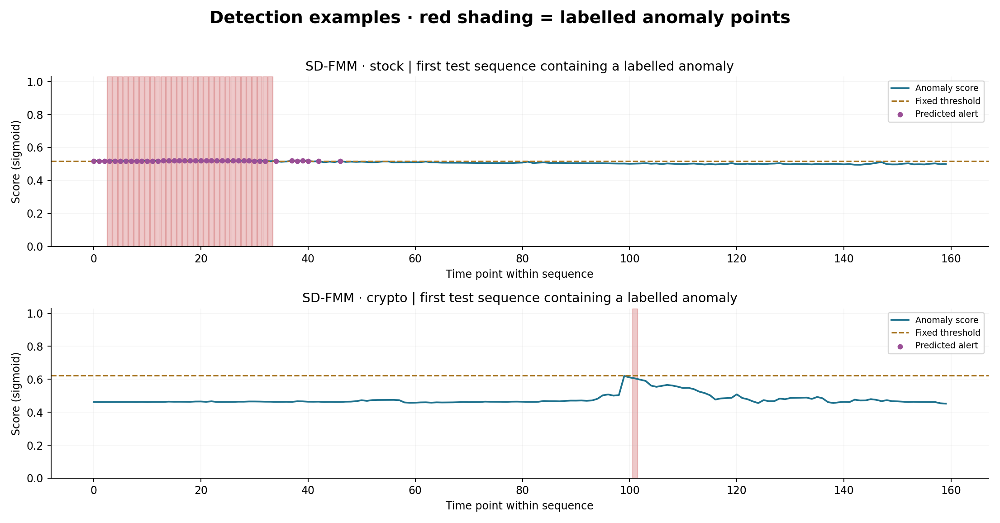

# 下载数据的实际检测结果 · 2026-11-03

本批次已实际完成 9 项公开任务及 1 项本地 IEEE-CIS 任务。每项数据分别微调原始 Kronos-mini，采用连续特征适配器、多尺度点级异常头（TSTR 使用整段注意力汇聚）与类别加权 BCE。没有把交易表伪装成 OHLC。公开任务由 CQ 免费 Kaggle GPU 执行，IEEE-CIS 在本地 CPU 执行；未使用付费租赁或 Colab CU。

固定随机种子 42，最多 5 轮，验证 AP 选 epoch，验证 F1 选阈值，再评估测试集。公开任务使用固定代码 `add76164bcacc34392b6dd9499a99f348f7cdc0e`；本目录正式结果没有混入先前的头部对照或一轮冒烟分数。所有 10 项训练的初始主干张量 SHA-256 一致，记录在 [protocol.json](protocol.json)。

| 数据集 | 检测单位 | 有标签测试数 | 异常数 | AP | 精确率 | 召回率 | F1 | TP / FP |
| --- | --- | ---: | ---: | ---: | ---: | ---: | ---: | ---: |
| SD-FMM 股票 | 时间点 | 960 | 99 | 0.5780 | 61.22% | 60.61% | 0.6091 | 60 / 38 |
| SD-FMM 加密资产 | 时间点 | 10,880 | 68 | 0.3565 | 42.62% | 38.24% | 0.4031 | 26 / 35 |
| TSTR | 整段序列 | 194 | 94 | 0.4878 | 50.00% | 94.68% | 0.6544 | 89 / 89 |
| ULB 信用卡 | 交易 | 42,724 | 52 | 0.3174 | 41.46% | 32.69% | 0.3656 | 17 / 24 |
| Sapienza 15S | 时间点 | 145,550 | 77 | 0.7524 | 80.00% | 62.34% | 0.7007 | 48 / 12 |
| Elliptic | 交易节点 | 8,841 | 408 | 0.2772 | 55.36% | 22.79% | 0.3229 | 93 / 75 |
| PaySim | 交易 | 955,744 | 4,010 | 0.0408 | 20.69% | 0.15% | 0.0030 | 6 / 23 |
| IBM AML HI-Small | 交易 | 769,140 | 1,567 | 0.0709 | 27.69% | 11.49% | 0.1624 | 180 / 470 |
| IBM TabFormer | 交易 | 3,658,953 | 4,454 | 0.0014 | 0.13% | 0.40% | 0.0020 | 18 / 13,559 |
| IEEE-CIS | 交易 | 88,581 | 3,083 | 0.1365 | 24.42% | 14.08% | 0.1786 | 434 / 1,343 |

AP 为 average precision，不是梯形积分 PR-AUC。橙点为测试异常占比，作为排名性能的参照。不同数据的检测单位、异常占比与划分不同，不计算一个混合总平均。加权 BCE 的 sigmoid 分数未经概率校准，不应解释为实际欺诈概率。

## 结果说明

- Sapienza 本轮 AP 0.7524、F1 0.7007，检测出 48/77 个异常起点，误报 12 个。该结果限于当前研究划分和 15S 分辨率。
- ULB 检测出 17/52 笔欺诈，误报 24 笔；IEEE-CIS 检测出 434/3,083 笔欺诈，误报 1,343 笔。两者还有明显漏报。
- PaySim 仅检测出 6/4,010 笔欺诈，召回率 0.15%；TabFormer 仅检测出 18/4,454 笔欺诈，召回率 0.40%，误报 13,559 笔。这些是本轮真实低召回结果，未用测试集重选阈值。
- TSTR 的 AP 0.4878 接近异常占比 94/194=0.4845；F1 0.6544 也接近“全部报异常”的 F1 0.6528。因此不能凭该 F1 宣称模型有效。
- Elliptic 的验证 AP 0.8132 降为测试 AP 0.2772；IBM AML 与 TabFormer 也出现验证到测试表现下降。单次结果提示泛化问题，尚不能从本实验断定具体原因。
- SD-FMM 股票仅有 6 个测试序列；市场序列为发布者加工的研究片段。本实验不支持实时交易、盈利或优于强基线的结论。

## 数据覆盖与限制

- PaySim、IBM AML、TabFormer：按完整时间周期划约 70/15/15，标签无关的块哈希选择 499,968 个训练目标和 99,968 个验证目标，保留各自完整测试段，未按标签平衡抽样。原始过去记录作为上下文，历史位置不重复计作目标；类别词表与数值预处理仅在训练段拟合。
- 上述三项实际训练／验证正例分别是 PaySim 291/33、IBM AML 380/100、TabFormer 569/104。它们不是全量训练成绩；测试交易数分别为 955,744、769,140、3,658,953，均没有下采样。
- ULB 使用全部交易的时间划分；Sapienza 按仓库的币种隔离研究划分，使用 15S。同一事件的 5S／25S 版本不重复当作独立数据集。TSTR、SD-FMM 使用仓库可复现研究划分，不冒充原论文的官方独立／零样本测试。
- Elliptic 按时间步 1–34 / 35–41 / 42–49 划分，仅用 94 个本地节点字段，不用图边或 72 个邻居聚合特征。测试段共 36,824 节点，其中 8,841 有标签、27,983 为 unknown；unknown 不进入指标。
- IEEE-CIS 使用官方带标签训练交易的 413,378 / 88,581 / 88,581 时间划分；官方无标签测试交易不作真实标签。只用 97 个时间／金额／距离／计数字段及产品／卡片类别编码特征，没有使用身份表或 V 字段；匿名 C 字段的在线可用性未独立核验。
- 三个大数据集当前使用全局时间流，不是单账户历史。不同交易在同一时间戳内以原始行号稳定排序。未使用交易后余额、规则标记、错误注释、洗钱模式注释或标签作为特征。

## 查看与复核

- [可筛选、自包含 HTML 报告](report.html)
- [完整 CSV 指标表](metrics.csv) · [机器可读汇总](aggregate_results.json)
- [独立复核记录](audit.json)：从保存的测试预测重算 AP、ROC-AUC、精确率、召回率、F1、混淆矩阵与 Brier，允许误差 1e-10，10 项全部通过。所有预测报警均符合预先固定阈值；测试源 ID 隔离检查通过。
- [训练记录](training_records) · [CQ 规范](cq_specs) · [代码、权重与运行协议](protocol.json)

曲线从全部保存的测试分数重新计算，绘图按召回率保留细节，并保留实际阈值点；表中 AP 使用完整分数。红点为验证集固定阈值的测试工作点，橙虚线为异常占比。

固定展示各测试文件中首个含标签异常的序列，不按模型分数或成功与否挑选。红色区域为真实标签，虚线为固定阈值，紫点为预测报警；加密资产这一示例没有触发报警，仍如实展示。

复现命令见[仓库 README](../../README.md#下载数据的批量实测与展示)。原始数据未改动；检查点、派生输入与逐笔预测保存在本机持久目录，未提交到公开仓库。IEEE-CIS 原始记录、类别词表、派生矩阵和逐笔预测均留在本机。本目录仅保存汇总指标、曲线、哈希和不含限制数据值的训练记录。
