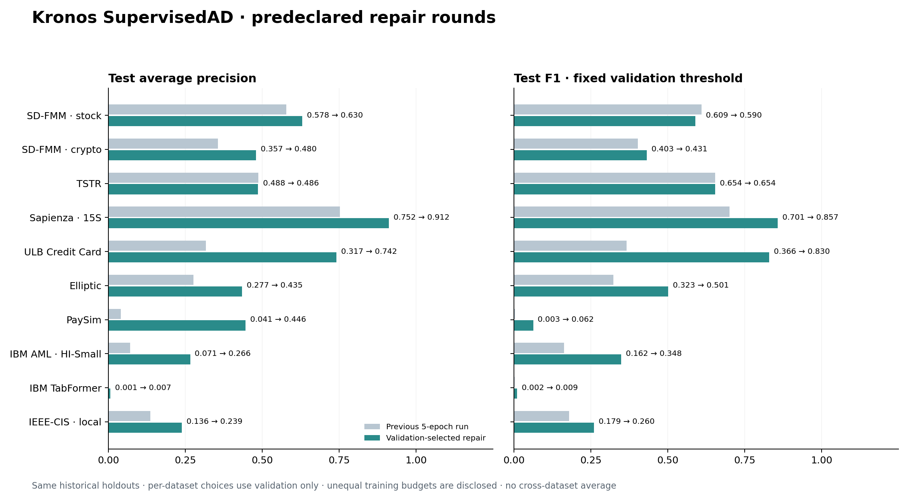
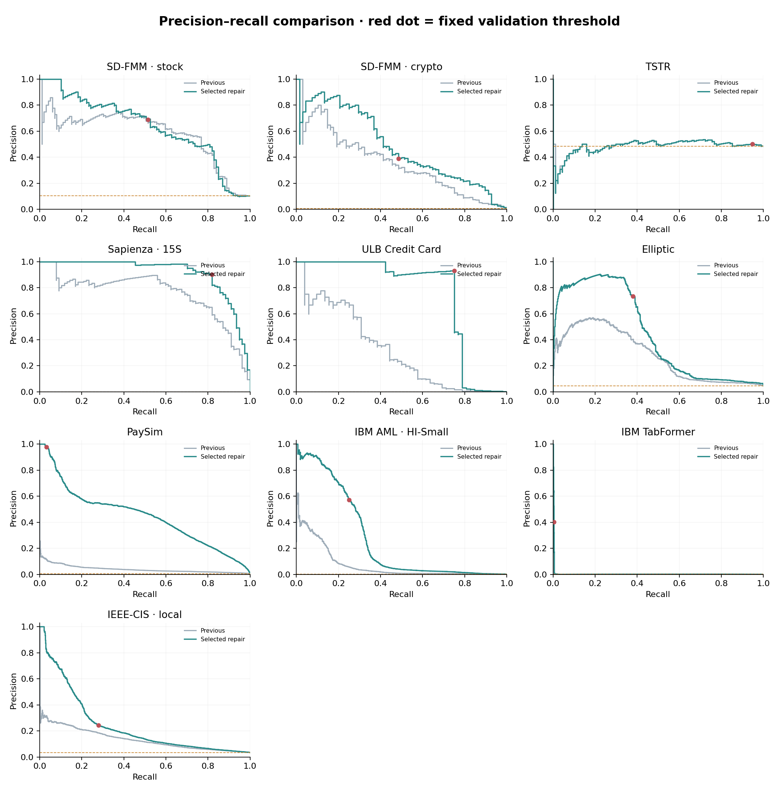

# Kronos SupervisedAD 多轮修复实测 · 2026-11-03

已完成 **40 次主实验训练（10 项任务 × 4 组）及 12 次额外种子确认**。主结果相对历史记录，9/10 项 AP 提高、8/10 项 F1 提高。所有方案按验证集选择；保留未改善项、退步项与误报代价，不按测试分数更换候选。

## 实际改进与协议

- R0：原多尺度头，最多 5 轮，作为参考。
- R1：增加原始交易特征及其因果多尺度变化的加性残差 MLP，训练预算和优化参数同 R0。整段任务另用 masked last/mean/std/max/min；不把这种离线汇聚冒充在线点检测。
- R2：残差头，加快学习率，最多 12 轮。
- R3：残差头，较保守学习率与正类权重上限 100，最多 12 轮。IEEE-CIS 权重约 27.43，上限未触发；该项主要对照学习率设置。

R1 是同预算的结构对照；R2/R3 是多参数训练优化组合，其提升不能全部归因于结构。详情见[预先声明协议](PROTOCOL.md)与[中文方法及命令](../../docs/supervised_repair_rounds_CN.md)。科学执行代码固定为 `573f0fc8419ef9c2dfd4927c71e2f3728c9a2785`；当前运行器的额外快照锁定仅为后续下载与复现加固，没有改写本轮实验。

每项数据用验证 AP、验证 F1 和较早方案的顺序选型。所有主候选训练时 `test.npz` 改名封存，选择 JSON 与哈希写入后才评估对应测试集。参考版始终有资格胜出。旧测试结果此前已公布，本轮是**历史留出集复测，不是全新外部盲测**。



| 数据 | 检测单位 | 选中方案 | 旧 AP → 新 AP | 旧 F1 → 新 F1 | 旧召回 → 新召回 | 旧 FP → 新 FP |
| --- | --- | --- | ---: | ---: | ---: | ---: |
| SD-FMM 股票 | 时间点 | r1_raw_residual | 0.5780 → 0.6303 | 0.6091 → 0.5896 | 60.61% → 51.52% | 38 → 23 |
| SD-FMM 加密资产 | 时间点 | r2_faster_longer | 0.3565 → 0.4803 | 0.4031 → 0.4314 | 38.24% → 48.53% | 35 → 52 |
| TSTR | 整段序列 | r0_reference | 0.4878 → 0.4858 | 0.6544 → 0.6544 | 94.68% → 94.68% | 89 → 89 |
| Sapienza 15S | 时间点 | r3_capped_weight | 0.7524 → 0.9119 | 0.7007 → 0.8571 | 62.34% → 81.82% | 12 → 7 |
| ULB 信用卡 | 交易 | r2_faster_longer | 0.3174 → 0.7419 | 0.3656 → 0.8298 | 32.69% → 75.00% | 24 → 3 |
| Elliptic | 有标签交易节点 | r2_faster_longer | 0.2772 → 0.4351 | 0.3229 → 0.5008 | 22.79% → 37.99% | 75 → 56 |
| PaySim | 交易 | r2_faster_longer | 0.0408 → 0.4456 | 0.0030 → 0.0623 | 0.15% → 3.22% | 23 → 3 |
| IBM AML HI-Small | 交易 | r2_faster_longer | 0.0709 → 0.2659 | 0.1624 → 0.3480 | 11.49% → 25.02% | 470 → 294 |
| IBM TabFormer | 交易 | r2_faster_longer | 0.0014 → 0.0066 | 0.0020 → 0.0093 | 0.40% → 0.47% | 13,559 → 31 |
| IEEE-CIS | 交易 | r2_faster_longer | 0.1365 → 0.2393 | 0.1786 → 0.2602 | 14.08% → 27.86% | 1,343 → 2,661 |

## 改善与剩余问题

- ULB 检测出 39/52 笔欺诈，误报由 24 降到 3；Sapienza 检测出 63/77 个异常起点，误报由 12 降到 7。两者在本轮历史留出集上同时改善检出与误报。
- PaySim 排名 AP 明显改善，但固定验证阈值仅检测出 129/4,010 个欺诈，召回率仍为 3.22%；TabFormer 仅检测出 21/4,454 个欺诈，召回率仍为 0.47%。这两项尚未解决低召回问题，不能只凭相对倍数增长宣称检测充分有效。
- TabFormer 选中方案验证 AP 约 0.2344，测试 AP 仅 0.0066；验证优势没有充分转移到后续时间段。具体原因未由本实验隔离，不能事后用测试标签重新调阈值。
- SD-FMM 股票的 AP 提高但 F1 略降，精确率提高、召回率降低；测试只有 6 条序列，不能作稳定普适结论。
- TSTR 选择了旧结构；AP 0.4858 仍接近异常占比 94/194=0.4845，F1 0.6544 也接近全报异常的 0.6528。它没有实质改善。历史参考与本轮存在重训／数值后端差异；AP 0.4878→0.4858 的微小变化不能单独归因于新结构，因为新结构并未被选中。
- IEEE-CIS 排名和召回改善，但历史 CPU 参照下 FP 从 1,343 增到 2,661。不能把“检出更多”写成“误报也降低”。

## 同设备私有对照

IEEE-CIS 的四组候选都在本机 MPS 上训练，单独保留同 MPS 的 R0 检查点，并在选择封存后评估。其 AP **0.1400 → 0.2393**，F1 **0.1941 → 0.2602**，召回率 **16.57% → 27.86%**，FP **1,670 → 2,661**。上方主表保留此前发布的 CPU 历史记录；同设备对照表明提升不只是 CPU/MPS 切换，但仍有报警负担代价。

同 MPS 验证结果：R0 AP/F1=0.1694/0.2336，R1=0.2039/0.2519，R2=0.2994/0.3278，R3=0.2635/0.2899。R2 与 R3 均在第 11 轮早停并保留第 8 轮，不能把最后训练轮次与选中 epoch 混为一谈。

## 额外种子确认

ULB、PaySim、TabFormer 已固定的 R2 配置分别与 R0 在种子 13、2026 上配对重跑，六对比较的 AP 与 F1 均改善，确认结果不再改变选型。下表另合并种子 42 的主结果作三个样本的描述统计；**参考种子 42 来自历史 CUDA 12.8，新增配对与修复版使用 CUDA 13.0，因此这不是完全同后端的纯种子方差实验**。± 为样本标准差，不是置信区间。

| 数据 | 方案 | AP 均值 ± 样本 SD | F1 均值 ± 样本 SD |
| --- | --- | ---: | ---: |
| ULB 信用卡 | R0 参考 | 0.5090 ± 0.1697 | 0.5283 ± 0.1706 |
| ULB 信用卡 | 固定 R2 | 0.7539 ± 0.0105 | 0.7842 ± 0.0552 |
| PaySim | R0 参考 | 0.0297 ± 0.0140 | 0.0098 ± 0.0074 |
| PaySim | 固定 R2 | 0.4515 ± 0.1972 | 0.1204 ± 0.1030 |
| IBM TabFormer | R0 参考 | 0.0013 ± 0.0003 | 0.0022 ± 0.0005 |
| IBM TabFormer | 固定 R2 | 0.0074 ± 0.0008 | 0.0109 ± 0.0015 |

PaySim 的修复版方差仍大；TabFormer 的绝对表现仍弱。其余任务没有额外种子确认，不报告不存在的置信区间。所有逐种子数值见 [seed_confirmation.json](seed_confirmation.json)。

## 可复现性与范围

- 48 次公开训练（36 次主试验 + 12 次确认）和 4 次本地训练的初始主干张量哈希均为 `9df7c94d97e7cd096ee1cbd982e8bbf219695a4d0ecdf22c15afb9dcb793f0c5`。每个任务各候选使用同一准备输入、同一训练／验证预处理规则及源 ID 隔离。
- 十项主预测已独立重算 AP、ROC-AUC、F1、精确率、召回率、混淆矩阵及 Brier，误差上限 1e-10，全部通过；报警标签与固定阈值一致。本地同设备参照也通过独立复核。额外确认保留汇总指标和检查点／输入哈希，不冒充其逐笔文件也已独立复核。
- 实验版本的 CPU 资格校验 56 项测试通过；当前代码加入快照下载测试后 58 项通过。选中的公开 CUDA hybrid 检查点已在本机 CPU/PyTorch 2.6 离线重载并验证输出形状及有限值。
- 历史公开环境为 PyTorch 2.11.0+cu128，本轮为 2.11.0+cu130；软件后端有差异，原始历史比较不是完全同环境消融。新增两个配对种子使用相同本轮后端；本地四轮和同设备参照统一为 MPS/PyTorch 2.6。
- PaySim、IBM AML、TabFormer 保持同样的标签无关训练目标上限 499,968、验证目标 99,968，完整时间测试段不变。原始数据与既有实验没有改动。不是全量训练成绩。
- Elliptic 仅使用本地节点字段，不用图边或邻居聚合特征；unknown 标签不进入指标。市场序列沿用发布者加工的研究划分，Sapienza 仅用 15S，不能据此声称官方独立／零样本、在线交易或盈利表现。不同检测单位不混算总平均。
- IEEE-CIS 继续使用官方带标签训练集的时间留出和原 97 维字段子集，不用官方无标签测试当真值；匿名 C 字段在线可用性未独立验证。其数据、类别词表、派生矩阵、逐笔预测与检查点均仅本机保存。
- 保留原始 Kronos 因果主干并不证明主干本身优于纯 MLP 或 GBDT；需要额外同协议控制来隔离预训练贡献。加权 BCE 分数未经风险概率校准。

## 文件与使用

- [自包含可筛选 HTML 报告](report.html) · [完整前后对照 CSV](comparison.csv) · [机器可读结果](comparison.json)
- [所有验证试验与训练记录](training_records) · [实际选中配置](selected_recipes.json)
- [十项主结果独立复核](audit.json) · [执行／环境协议](execution_protocol.json) · [CQ 作业规范](cq_specs)
- [额外种子 CSV](seed_confirmation.csv) · [方法与重跑命令](../../docs/supervised_repair_rounds_CN.md)



模型与逐笔预测已另存本机持久目录，未放入公开仓库；本目录只保存不含限制数据值的聚合结果、图表、配置与哈希。公开数据使用 CQ 免费 Kaggle，本地私有数据使用本机计算，未动用付费租赁或 Colab CU。

默认单次训练入口继续兼容旧方法；推荐使用验证选择流程，不无条件把每项数据切到同一新配置：

```bash
python scripts/refine_supervised.py --stage batch --datasets ulb --device cuda --output runs/repair-ulb
```
